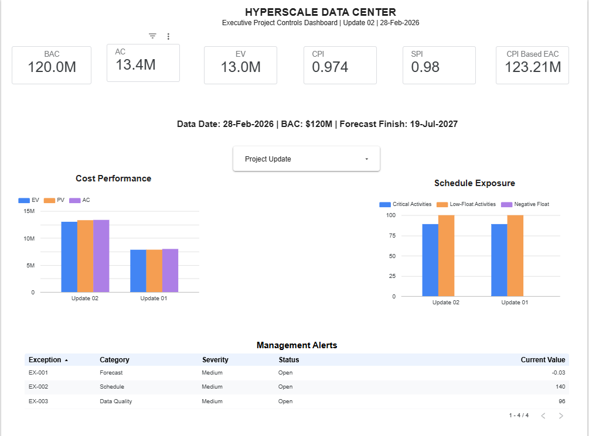

# Hyperscale Data Center | Integrated Project Controls

**Primavera P6 · Planning & Scheduling · Earned Value Management · Forecasting · Executive Reporting**

> **Management question:** How is project delivery performance changing, what does the latest forecast indicate, and where should management intervene?

This independent **synthetic project-controls case study** connects baseline planning, progress updates, cost and schedule performance analysis, forecasting and management reporting for a hyperscale data-center development.

[← Portfolio overview](../README.md) · [Schedule evidence](./primavera/) · [Dashboard gallery](./dashboard/) · [Methodology](./docs/methodology.md) · [Reporting data](./data/)

---

## Executive project profile

| Parameter | Case-study basis |
| --- | --- |
| Project | Hyperscale Data Center Development |
| Project ID | DC-HYP-FINAL-6 |
| Schedule | **808 activities · 1,406 relationships** |
| Cost baseline | **USD 120 million** (synthetic) |
| Baseline project start | **05 January 2026** |
| Baseline readiness-for-service (RFS) | **15 July 2027** |
| Update 01 data date | **31 January 2026** |
| Update 02 data date | **28 February 2026** |
| Reported current RFS forecast | **19 July 2027** |
| Tools | Primavera P6, Excel, Python/Pandas (data-processing workflow), Google Sheets, Looker Studio |

**Project objective:** demonstrate a repeatable reporting workflow that helps a project-controls team move from a static schedule snapshot to **performance trends, forecast interpretation and prioritized actions**.

## 01 — Planning & baseline control

The Primavera P6 schedule was structured around engineering, procurement, construction, electrical/mechanical systems, utility energization, testing and commissioning, and handover.

- Structured WBS, milestones, calendars and activity relationships.
- Reviewed schedule logic, critical-path continuity and float exposure.
- Developed a baseline readiness-for-service milestone for subsequent comparison.

**Evidence:** [Baseline schedule summary](./primavera/baseline-schedule-summary.pdf)

## 02 — Progress monitoring

Successive reporting periods support assessment of performance movement rather than a single status point.

| Reporting milestone | Data date | Purpose |
| --- | --- | --- |
| Baseline | 05 Jan 2026 | Planned delivery reference |
| Update 01 | 31 Jan 2026 | Initial progress and forecast comparison |
| Update 02 | 28 Feb 2026 | Subsequent period and emerging performance trends |

[Update 01 schedule summary](./primavera/update-01-schedule-summary.pdf) · [Update 02 schedule summary](./primavera/update-02-schedule-summary.pdf)

## 03 — Earned value & forecast intelligence

The analysis brings together:

| Cost / EVM | Schedule | Forward-looking measures |
| --- | --- | --- |
| BAC, PV, EV, AC | Critical and low-float exposure | EAC, ETC, VAC |
| CPI, SPI, CV, SV | Milestone forecast movement | Cost-to-complete scenarios |
| Period-on-period performance | Design/procurement interfaces | Management alerts |

**Methodological distinction:** the cost baseline is synthetic, and the EVM/reporting workflow uses external analytical calculations. It should **not** be interpreted as verified native Primavera P6 earned-value output. KPI ratios are computed from **aggregated EV, AC and PV**, rather than summing activity-level ratios. Reporting-period controls are needed to avoid double-counting updates.

See [methodology and limitations](./docs/methodology.md).

## 04 — Executive dashboard

| Executive overview | Cost & forecasting | Schedule & risk |
| --- | --- | --- |
| [View dashboard](./dashboard/01-executive-overview.png) | [View dashboard](./dashboard/02-cost-forecast.png) | [View dashboard](./dashboard/03-schedule-risk.png) |

The dashboard is designed to answer: **Where are we? What changed? What is forecast? What needs action?**

## 05 — Management interpretation

**Illustrative findings from the modeled updates:**

1. **Protect design-to-procurement interfaces.** Delays to architectural/electrical design release can affect long-lead transformer procurement and downstream electrical milestones.
2. **Monitor readiness for energization and commissioning.** Equipment delivery and integrated testing create important schedule interfaces that warrant active follow-up.
3. **Interpret CPI/SPI together with schedule evidence.** Near-target performance indices do not remove critical-path or interface exposure.
4. **Review cost forecasts as scenarios, not commitments.** Synthetic progress and cost assumptions make EAC values useful for demonstrating analytical methods, not predicting a real project outcome.

**Management decision supported:** prioritize design-release follow-up, track long-lead procurement milestones, and monitor forecast movement and schedule quality at each reporting date.

---

## Evidence and repository navigation

| Folder | Contents |
| --- | --- |
| [`primavera/`](./primavera/) | Baseline and update schedule PDFs |
| [`dashboard/`](./dashboard/) | Three executive dashboard screenshots |
| [`data/`](./data/) | Case-study reporting workbook and data notes |
| [`docs/`](./docs/) | Methodology and modeling limitations |
| [`notebooks/`](./notebooks/) | Data-processing workflow notes; **no executable notebook is currently committed here** |

### Status and limitations

- **Available:** P6 schedule summaries, reporting workbook, executive dashboard screenshots.
- **Documented analytical workflow:** P6 → structured reporting data → EVM/forecast analysis → dashboard.
- **Not currently available in this repository:** a complete executable, reproducible Python notebook for the Data Center workflow.
- **Quality control before external presentation:** verify dashboard figures, data-date filters, forecast labels and management text against the same reporting period.

**Disclosure:** This is a synthetic portfolio case study. Dates, budgets, progress and analysis illustrate project-controls methods; they do not represent a real client's performance or an independently verified forecast.

[← Back to portfolio](../README.md)
