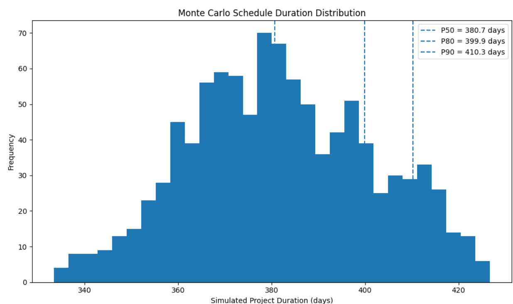

# Monte Carlo Schedule Risk | Exploratory Simulator V1

**Schedule Uncertainty · Probabilistic Thinking · Project Controls Decision Support**

[← Portfolio overview](../README.md)

> **Management question:** How could activity-duration uncertainty affect the expected project completion outcome, and how should that uncertainty be communicated?

This repository contains an **early exploratory Monte Carlo prototype** using Primavera P6-related schedule data and Python. It demonstrates probabilistic thinking but **does not implement full CPM network recalculation**.

## Current published V1

- Uses **1,000 simulations** with simplified duration assumptions.
- Illustrates distribution-based outputs, including P50/P80/P90-style measures.
- Includes notebook implementations, screenshots and an Excel summary.
- Uses a simplified completion proxy rather than recomputing all precedence relationships, lags, calendars and the controlling path per simulation.

**Critical interpretation:** The resulting percentiles are **illustrative outputs of this simplified model**, not defensible contractual project-finish confidence dates or a validated Primavera quantitative schedule risk analysis.

## Available evidence

| Artifact | Link |
| --- | --- |
| Initial notebook | [Monte-Carlo-Schedule-Risk.ipynb](./notebook/Monte-Carlo-Schedule-Risk.ipynb) |
| Alternative V1 notebook | [MonteCarlo_V01.ipynb](./notebook/MonteCarlo_V01.ipynb) |
| Duration distribution | [Screenshot](./screenshots/duration_distribution.png) |
| Executive summary example | [Screenshot](./screenshots/executive_summary.png) |
| Excel output | [Monte_Carlo_Summary.xlsx](./outputs/Monte_Carlo_Summary.xlsx) |

## Planned technical upgrade — not yet published here

A more rigorous network-aware case study is being developed to:

1. Parse P6 activities and relationships and validate schedule integrity.
2. Document risk-based duration distributions and assumptions.
3. Recalculate simplified CPM network logic during each simulation.
4. Report indicative P50/P80/P90 finish outcomes and target confidence.
5. Examine sensitivity, modeled criticality, contingency and mitigation scenarios.
6. Document calendar, constraint, baseline-date and model-validation limitations.

**Status:** This is a roadmap, not a claim that these improvements exist in the published V1 repository. Results from a separate development notebook should not be quoted here until checked and committed.

## Professional relevance

The intended Project Controls outcome is to connect **schedule uncertainty → completion confidence → risk drivers → contingency → management action**, rather than present simulation code as the primary deliverable.

**Disclosure:** This is an independent portfolio prototype using illustrative/simulated assumptions. It is not a live-client schedule assessment, forensic delay analysis or commercial schedule-risk certification.
