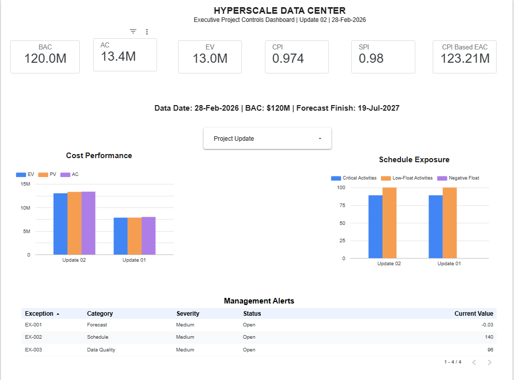
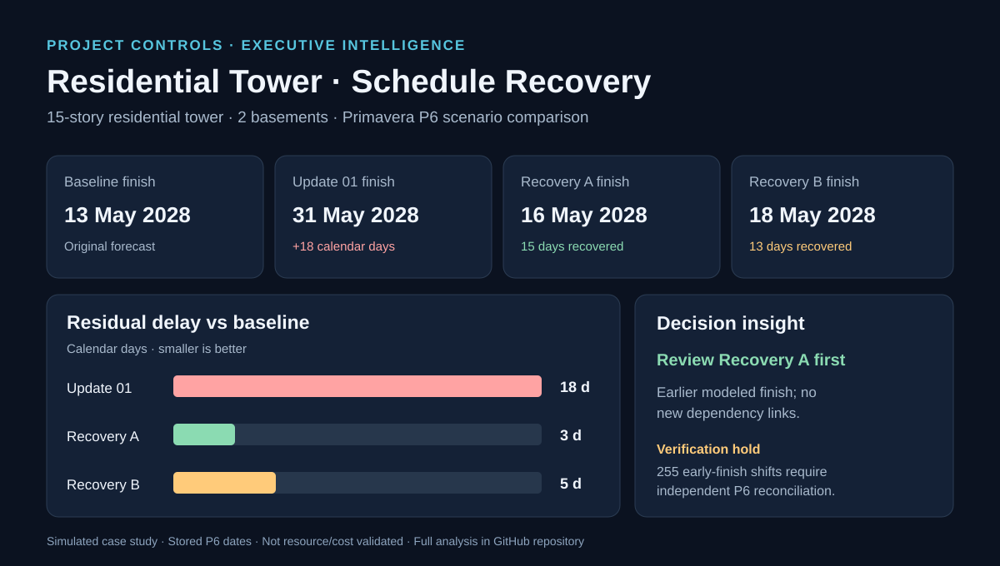

# Project Controls & Project Intelligence
### Engineering-led planning, performance management, schedule risk and digital project controls

**Primavera P6 · Planning & Scheduling · Earned Value Management · Forecasting · Schedule Risk · PMO Analytics · Python & BI Automation**

> **From project schedules and performance data to informed delivery decisions.**

An independent portfolio of engineering-led case studies demonstrating the integration of **Primavera P6 scheduling, project performance measurement, forecasting, quantitative risk analysis and executive reporting**. The emphasis is on **project-controls methodology, schedule integrity, management insight and decision support**—with Python and business intelligence used to make analysis more consistent and repeatable.

**Professional background:** Civil Engineering · Master's in Engineering Management  
**Career focus:** Project Controls Engineer / Analyst · Planning & Scheduling Engineer · PMO Analyst · Digital Project Controls  
**Geographic focus:** United Arab Emirates and Saudi Arabia  
**Quick recruiter briefing:** [Read the one-page Project Controls overview](./RECRUITER-OVERVIEW.md)

---

## Two flagship capital-project case studies

My portfolio is organized around two complementary management problems: **predicting delivery exposure** and **evaluating corrective action**. Both are independent, synthetic engineering case studies, not client engagements.

| Flagship | Management question | Evidence | Decision-support deliverable |
| --- | --- | --- | --- |
| **[Hyperscale Data Center — Integrated Controls & Schedule Risk](./Hyperscale-Data-Center/)** | How can leadership interpret changing performance and emerging schedule uncertainty? | 808 activities, 1,406 relationships; USD 120m synthetic baseline; progress updates; 10,000-run illustrative network Monte Carlo | Executive controls dashboard, forecast interpretation and [experimental schedule-risk report](./Hyperscale-Data-Center/docs/monte-carlo-experimental-results.md) |
| **[Residential Tower — Schedule Recovery & Options Appraisal](./Residential-Tower-Project-Controls/)** | Which recovery strategy merits further feasibility assessment? | Four P6 XER scenarios; 265 activities each; +18-day update delay; Recovery A/B comparisons | [Executive decision brief](./Residential-Tower-Project-Controls/05_Reports/Executive_Decision_Brief.md), recovery dashboard and gated recommendation |

**My approach:** establish the schedule evidence, test assumptions, quantify the implications, and communicate a management decision together with its validation conditions. Python and dashboards support the engineering analysis; they are not the primary outcome.

**What is verified versus provisional:** Residential Tower scenario differences are taken from stored P6 fields, not independent CPM recalculation. The Data Center Monte Carlo is a continuous-hour experiment with illustrative duration assumptions; its percentiles are **not** validated contractual completion dates.

---

## Featured case study 01 — Hyperscale Data Center
### Integrated Project Controls | Primavera P6 · EVM · Forecasting · Executive Reporting

**The management challenge:** A schedule or dashboard snapshot alone does not explain how delivery performance is evolving—or what the latest update means for the forecast.

This simulated hyperscale data-center case study develops an integrated Project Controls workflow: **PLAN → UPDATE → ANALYZE → FORECAST → REPORT → DECIDE**.

| Project parameter | Portfolio case-study basis |
| --- | --- |
| Schedule | **808 activities · 1,406 relationships** |
| Cost baseline | **USD 120 million** (synthetic) |
| Baseline readiness-for-service milestone | **15 July 2027** |
| Reporting approach | Multiple progress updates and performance comparisons |
| Analysis | Critical path, float exposure, PV / EV / AC, CPI / SPI, EAC / ETC / VAC |
| Reporting | Executive dashboard and management-oriented interpretation |

**What the case study demonstrates**
- Development and review of an integrated Primavera P6 baseline schedule, WBS and logic network.
- Progress-update comparison and monitoring of schedule and cost-performance indicators.
- Earned value and estimate-at-completion analysis using documented modeling assumptions.
- Executive reporting designed to highlight performance movement, schedule exposure and management priorities.

**Executive dashboard preview**

[](./Hyperscale-Data-Center/)

[**Executive overview**](./Hyperscale-Data-Center/dashboard/01-executive-overview.png) · [**Cost & forecasting**](./Hyperscale-Data-Center/dashboard/02-cost-forecast.png) · [**Schedule & risk**](./Hyperscale-Data-Center/dashboard/03-schedule-risk.png)

**My management interpretation:** I use schedule updates and modeled uncertainty to identify the interfaces leadership should investigate first—design release, long-lead equipment, energization and commissioning. The 10,000-run risk experiment adds a reproducible relative-hour P80 screening result, not a contractual date forecast.

**[Explore the complete Data Center case study →](./Hyperscale-Data-Center/)** · [**Monte Carlo executive dashboard**](./Hyperscale-Data-Center/dashboard/monte-carlo-executive.html) · [**Experimental risk results**](./Hyperscale-Data-Center/docs/monte-carlo-experimental-results.md)

---

## Featured case study 02 — Residential Tower Schedule Recovery
### Primavera P6 · Progress Updates · Recovery Analysis · Executive Decision Support

**Management challenge:** An updated simulated 15-story residential tower schedule forecasts completion **18 calendar days late**. Two alternative recovery strategies are evaluated against the same baseline.

| Scenario | Forecast finish | Delay vs baseline | Days recovered |
|---|---|---:|---:|
| Baseline | 13 May 2028 | 0 | — |
| Update 01 | 31 May 2028 | +18 | — |
| Recovery A — duration compression | 16 May 2028 | +3 | 15 |
| Recovery B — logic resequencing | 18 May 2028 | +5 | 13 |

**My decision recommendation:** Advance Recovery A for controlled feasibility review, **not implementation approval**. Its earlier stored finish requires schedule-integrity verification: 255 activity early-finish dates move earlier, far beyond the four compressed activities. Acceleration productivity, resources and cost remain unvalidated. Recovery B introduces overlap-related interface risks. The recommended next step is a controlled feasibility and cost review—not immediate implementation.

**Evidence:** Four original Primavera P6 XER files; 265 activities per scenario; Python extraction and reproducible comparison; executive risk and decision brief. Simulated schedules, not live project results.

[](./Residential-Tower-Project-Controls/04_Dashboard/)

**[Explore the Residential Tower recovery case study](./Residential-Tower-Project-Controls/)** · [**Executive dashboard**](./Residential-Tower-Project-Controls/04_Dashboard/)

---

## Supporting capability — Schedule Health & Assurance
### Primavera P6 Schedule Quality | Planning Integrity · Exceptions · Corrective Actions

**The management challenge:** Forecasts are only as reliable as the schedule logic and data supporting them.

**In development.** Planned scope includes review of open-ended activities, constraints, long durations, relationship logic, float exposure and other schedule-quality exceptions, followed by prioritized corrective actions and an executive findings report.

This case study will complement performance reporting and probabilistic analysis by focusing on **schedule reliability and planning assurance**.

---

## Additional analytical projects

The following are **supporting proof-of-concept exercises**, presented separately from the flagship case studies.

| Project | Project-controls relevance |
| --- | --- |
| [Monte Carlo Schedule Risk Simulator V1](./Monte-Carlo-Schedule-Risk-Simulator/) | Early illustrative duration-risk exercise; superseded for flagship presentation by the Data Center network experiment |
| [Primavera P6 Baseline Risk Intelligence Engine V1](./Primavera_P6_Baseline_Risk_Intelligence_Engine_V1/) | Structured baseline risk screening and prioritization |
| [Performance-Driven Risk & Forecasting Engine V03](./Performance-Driven-Risk-Forecasting-Engine-V03/) | Performance metrics and exploratory forecasting |
| [Project Controls Early Warning System V01](./Project_Controls_Early_Warning_System_V01/) | Rule-based issue detection, alerts and escalation |
| [FIDIC Claims & EOT Intelligence Assistant V01](./FIDIC-Claims-EOT-Intelligence-Assistant-V01/) | Early-stage delay-event and documentation screening; **not a contractual entitlement determination or forensic delay analysis** |

---

## Project Controls capabilities

| **Planning & Scheduling** | **Performance & Forecasting** | **Risk & Digital Reporting** |
| --- | --- | --- |
| Primavera P6, WBS and milestones | Earned Value Management | Schedule risk concepts and Monte Carlo |
| CPM logic and float analysis | PV, EV, AC; CPI and SPI | Schedule-quality and exception checks |
| Baseline and progress updates | EAC, ETC and VAC scenarios | Python, Pandas, NumPy and Excel |
| Schedule interfaces and critical path | Management reporting and variance review | Looker Studio and reporting automation |

### Methodology and decision focus

```text
ENGINEERING SCHEDULE & BASELINE
              ↓
     PROGRESS / COST UPDATES
              ↓
    PERFORMANCE & VARIANCES
              ↓
  FORECASTS / RISK / ASSURANCE
              ↓
  MANAGEMENT FINDINGS & ACTIONS
```

**The tools support the decisions—not the other way around.** The portfolio is intentionally presented through business problems, analytical methods, evidence, limitations and recommended management actions rather than code alone.

---

## Professional interests and collaboration

Open to discussions and opportunities across **the UAE and Saudi Arabia**, particularly in:

- **Project Controls Engineering & Analysis**
- **Planning and Scheduling / Primavera P6**
- **PMO Reporting, Performance and Governance Analytics**
- **Digital Project Controls and Reporting Automation**
- **Schedule Diagnostics, Risk and Forecasting Support**

For potential project-based collaboration, areas of interest include scoped **P6 schedule health diagnostics, project-controls reporting automation and performance-analysis support**, subject to project requirements, data quality and appropriate professional review.

---

### Important disclosure

All flagship project scenarios and numerical examples in this portfolio are **independent, synthetic or simulated case studies**. They demonstrate technical methods and engineering analysis; they **do not represent direct responsibility for live client projects**. Assumptions, model simplifications and limitations should be reviewed in the relevant project documentation. In particular, synthetic cost data and risk inputs are not a substitute for actual project records, validated estimates or expert contractual judgment.

**Start here: [Hyperscale Data Center — Integrated Project Controls](./Hyperscale-Data-Center/)**

