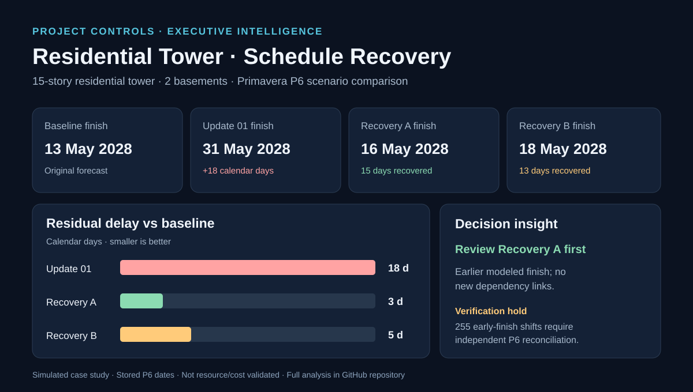

# Residential Tower — Executive Dashboard

## Interactive four-page dashboard

[Open the HTML dashboard source](./index.html). GitHub shows the HTML source in its viewer. To use the dashboard, download the file and open it in a web browser. The dashboard is self-contained, responsive, printable, and works offline.

### Pages

1. **Executive Overview** — baseline, update, recovery finish dates, modeled delay recovery and conditional management recommendation.
2. **Schedule Performance** — completed/in-progress/not-started activity counts, percentages and nonpositive-float screening.
3. **Recovery Analysis** — four duration reductions for Recovery A; three FS-to-SS replacements and an added handover link for Recovery B.
4. **Risks & Decisions** — qualitative decision matrix, risks and approval gates.

### Data products

- [Scenario KPIs](./Scenario_KPIs.csv) — four scenarios, scheduled finishes, activity/relationship counts and status counts.
- [Recovery interventions](./Recovery_Interventions.csv) — activity compression and logic modifications.
- [Python scenario audit](../02_Python_ETL/analyze_scenarios.py) — regenerates scenario summary and detailed change tables from the four bundled P6 XER exports.
- [Detailed engineering analysis](../05_Reports/Detailed_Engineering_Analysis.md) — interpretation, verification issues and management recommendations.

The HTML contains a fixed, source-grounded snapshot rather than a live data connection. The XER project finish dates are **stored P6 values, not independently recalculated CPM**. Activity status counts do not measure weighted physical progress. No cost, resource or constructability validation is implied.

**Important:** Recovery A's 255 earlier exported activity early-finish dates must be reconciled to scheduling settings and driving logic before the modeled recovery is accepted.

### Publishing a hosted URL

The dashboard is committed to GitHub, but a public GitHub Pages site is **not yet configured**. A repository administrator can enable GitHub Pages, or the HTML can be hosted as a static page. No hosted URL should be claimed until it is verified.
